# Hi, I’m ZiDiYao 👋

### Software engineering at McMaster University · Coding & photography

I’m interested in backend systems, AI-powered applications, and building useful tools. Here are some of the projects I’m working on.

[Portfolio & photography](https://zidiyao.com/) · [All repositories](https://github.com/ZiDiYao?tab=repositories) · [Get in touch](mailto:zidiyaocanada@outlook.com)

## Featured Projects

<table width="100%">
<tr>
<td width="50%" valign="top">

### 🔎 [EchoFilter](https://github.com/ZiDiYao/EchoFilter)
**AI-assisted comment analysis**

Analyzes online comments for misinformation, toxicity, facts, and opinions, returning structured annotations and trust scores.

**Inside the project**
- Asynchronous analysis pipelines with Kafka
- Redis caching and MySQL storage
- Streaming results through SSE / WebSocket

`Java` · `Spring Boot` · `Kafka` · `Redis` · `MySQL`

**[Explore the code →](https://github.com/ZiDiYao/EchoFilter)**

</td>
<td width="50%" valign="top">

### 🚨 [MEC EchoTeams](https://github.com/ZiDiYao/MEC_EchoTeams)
**Emergency transcript analysis**

A team project exploring how AI can turn emergency call transcripts into structured incident information.

**Inside the project**
- Extracts incident type, urgency, and key details
- React interface with analysis history
- Spring Boot API connected to DeepSeek

`Java` · `Spring Boot` · `React` · `DeepSeek API`

**[Explore the code →](https://github.com/ZiDiYao/MEC_EchoTeams)**

</td>
</tr>
<tr>
<td width="50%" valign="top">

### 🚕 [Uber Clone Backend](https://github.com/ZiDiYao/uber-clone-backend)
**Ride-hailing backend architecture**

A backend modeled after Uber, with separate services for users, drivers, and administrators.

**Inside the project**
- Multi-module, microservices architecture
- Ride requests and real-time driver acceptance
- Separation of responsibilities across services

`Java` · `Microservices` · `Backend systems`

**[Explore the code →](https://github.com/ZiDiYao/uber-clone-backend)**

</td>
<td width="50%" valign="top">

### 🧩 [MiniEFCore](https://github.com/ZiDiYao/MiniEFCore)
**Building an ORM from scratch · In progress**

A C# learning project exploring how an ORM connects application objects to relational data.

**Design focus**
- Entity discovery and mapping through reflection
- Change tracking and a save pipeline
- SQL generation and object materialization

`C#` · `.NET` · `Reflection` · `ORM design`

**[Explore the design & code →](https://github.com/ZiDiYao/MiniEFCore)**

</td>
</tr>
<tr>
<td width="50%" valign="top">

### 🗓️ [DailyGrid](https://github.com/ZiDiYao/DailyGrid)
**Habits, visualized**

A habit tracker and visualization project for recording daily activities and seeing consistency over time.

**Project focus**
- Daily activity tracking
- Grid-based charts
- Visual feedback on habits and progress

`Python` · `Data visualization` · `Habit tracking`

**[Explore the code →](https://github.com/ZiDiYao/DailyGrid)**

</td>
<td width="50%" valign="top">

### 📷 [Photography Portfolio](https://github.com/ZiDiYao/photography-site)
**Where code meets photography**

A responsive React portfolio presenting street, portrait, city, and landscape photography.

**Inside the project**
- Minimal dark interface
- Category-based photo browsing
- React Router navigation and custom CSS

`React` · `JavaScript` · `CSS`

**[Visit the website →](https://zidiyao.com/)** · **[View code →](https://github.com/ZiDiYao/photography-site)**

</td>
</tr>
</table>

## Toolbox

| Languages | Frameworks & UI | Data & messaging |
| :--- | :--- | :--- |
| Java · C# · Python · JavaScript | Spring Boot · .NET · React | MySQL · Redis · Kafka |

## Beyond the projects

I also enjoy photography. You can browse my work at **[zidiyao.com](https://zidiyao.com/)** or explore **[My_Photography](https://github.com/ZiDiYao/My_Photography)**.

**Contact:** [zidiyaocanada@outlook.com](mailto:zidiyaocanada@outlook.com) · [yaoz25@mcmaster.ca](mailto:yaoz25@mcmaster.ca)

---

