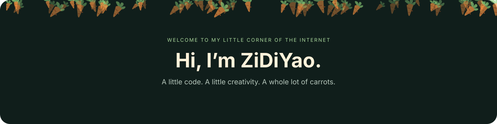
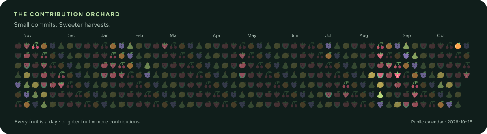

  <b>Software engineering · Coding · Photography</b> 
  Studying Software Engineering at McMaster University. 
  Growing ideas into projects, one commit at a time. 🥕

  <a href="https://zidiyao.com/">Website</a> ·
  <a href="https://github.com/ZiDiYao/My_Photography">Photography</a> ·
  <a href="mailto:zidiyaocanada@outlook.com">Say hello</a>

### A fresh commit, a sweeter harvest 🍓

Grown from my public GitHub contribution calendar · refreshed daily

### Find me in the garden 🌱

- 📷 Interested in coding & photography. Explore [My_Photography](https://github.com/ZiDiYao/My_Photography)!
- 🎓 McMaster University · Software Engineering
- ✉️ [zidiyaocanada@outlook.com](mailto:zidiyaocanada@outlook.com) · [yaoz25@mcmaster.ca](mailto:yaoz25@mcmaster.ca)
